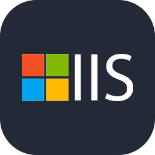
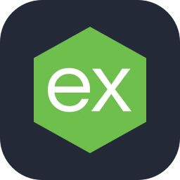

# Abner Delfino Matías Bartolo — NerMat17

**Ingeniero en Sistemas Computacionales · Desarrollador Full Stack · En camino a Cloud & DevOps**

Diseño, implemento y opero sistemas web que corren todos los días en planta dentro de la industria automotriz:
APIs, bases de datos, monitoreo en tiempo real e integración con equipos de piso.
Hoy estoy llevando ese stack hacia la nube, con AWS, contenedores y CI/CD.

&nbsp;

Querétaro, México

---

## Sobre mí

- **3 años** como **Desarrollador Full Stack** en Nihon Plast Mexicana, en un entorno de operación continua 24/7 del sector automotriz.
- Stack principal: **Node.js + SQL Server**, con React moderno (Material UI, React Query, Vite) en el frontend.
- Me interesa todo el ciclo: levantar requerimientos, diseñar la base de datos, construir la API, desplegar y darle soporte en producción.
- Objetivo: convertirme en un **Full Stack Engineer con responsabilidad de Cloud y DevOps** que diseñe, implemente y despliegue sistemas de punta a punta.

## Proyectos que he liderado en producción

| Proyecto | Qué resolvió | Stack principal |
|---|---|---|
| **Sistema Multi-Planta de Reportes de Producción** | Digitalizó el reporte de producción por turno en todas las plantas. Redujo el tiempo de llenado por operador de **15 a 5 min (−67 %)** y eliminó **+8 000 hojas/mes** de captura manual. | Node.js · Pug · Socket.io · Redis · SQL Server · Sequelize · Raspberry Pi 5 |
| **Portal de Trazabilidad y Métricas de Producción** | Consolidó la trazabilidad de volantes a lo largo de hasta **14 estaciones por modelo**, con dashboards operacionales multi-línea y módulo de reprocesos a nivel de componente. | React · Material UI · React Query · Recharts · Vite · Node.js · SQL Server |
| **Sistema de Trazabilidad por QR** | Trazabilidad end-to-end en línea de inyección de magnesio, con integración **OPC UA** a un PLC y poka-yoke para lecturas automáticas de sensores. | Node.js · Socket.io · OPC UA · SQL Server · Pug · Chart.js |
| **Gestor de Documentos y Planos Técnicos** | Centralizó documentos y dibujos técnicos (PDF/TIF) con autenticación multirol, control de versiones y estado vigente/obsoleto. | C# · Windows Forms · .NET Framework · SQL Server |

## Proyecto personal

**[LisSystem](https://github.com/NerMat17/LisSystem)** *(en desarrollo)* — Sistema Andon digital open-source para monitoreo de líneas de producción en tiempo real: levantamiento y seguimiento de paros con cronómetro, conteo de piezas vía simulador OPC UA, dashboards por turno y CRUD administrativo. Construido con **arquitectura por capas y principios SOLID**.

**Stack:** TypeScript · Node.js · Express · Socket.io · JWT · SQL Server · Sequelize · React · Tailwind CSS

## Lo que hago en el día a día

- APIs REST, lógica de negocio y validaciones con **Node.js / Express**
- Funcionalidades en tiempo real con **WebSockets (Socket.io)** y **Redis** para pub/sub distribuido entre plantas
- Diseño y optimización de bases de datos: consultas, índices, procedimientos almacenados y ORM en **SQL Server** (Sequelize / Tedious)
- Integración con dispositivos industriales vía **OPC UA, KepServer y Node-RED** (PLCs, poka-yokes, Raspberry Pi, impresoras y escáneres industriales)
- Despliegue en **Windows Server** y **Linux**, con servicios Node.js corriendo 24/7 (**PM2, Node-windows, IIS**)
- Soporte productivo: administración de SQL Server, respaldos, mantenimiento remoto (TeamViewer)

## Tecnologías

<b>Lenguajes</b>  
  
  
  
  
  
  

<b>Backend</b>  
  
  
  
  
  

<b>Frontend</b>  
  
  
  
  
  
  
  
  

<b>Bases de datos</b>  
  
  
  
  
  

<b>Infraestructura y herramientas</b>  
  
  
  
  
  
  
  
  
  

<b>Integración industrial</b>  
  
  
  

<b>Aprendiendo ahora</b>  
  
  

## Formación y certificaciones

- **Ingeniería en Sistemas Computacionales** — Instituto Tecnológico Superior de Tamazunchale (2020 – 2024)
- **Meta React Specialization** — Meta, Coursera (sep 2026) · [Ver credencial](https://coursera.org/verify/specialization/GMAE7EES6O7S)
- **AWS Cloud Technical Essentials** — Amazon Web Services, Coursera · *En curso*
- **NDG Linux Unhatched** — Cisco Networking Academy (sep 2022)

## Enfoque actual

- Servicios de **AWS** y fundamentos de cloud, con miras a la certificación **AWS Cloud Practitioner**
- Contenerización con **Docker**
- Pipelines de **CI/CD** y automatización de despliegues
- Arquitecturas escalables y resilientes
- Terminando **LisSystem** como proyecto open-source de referencia (TypeScript + SOLID + arquitectura por capas)

## Estadísticas

  
  

 

<picture>
  <source media="(prefers-color-scheme: dark)" srcset="https://raw.githubusercontent.com/NerMat17/NerMat17/output/pacman-contribution-graph-dark.svg">
  <source media="(prefers-color-scheme: light)" srcset="https://raw.githubusercontent.com/NerMat17/NerMat17/output/pacman-contribution-graph.svg">
  
</picture>
